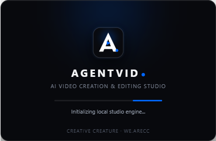
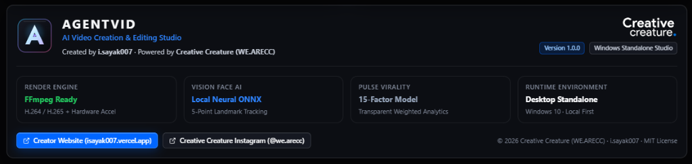
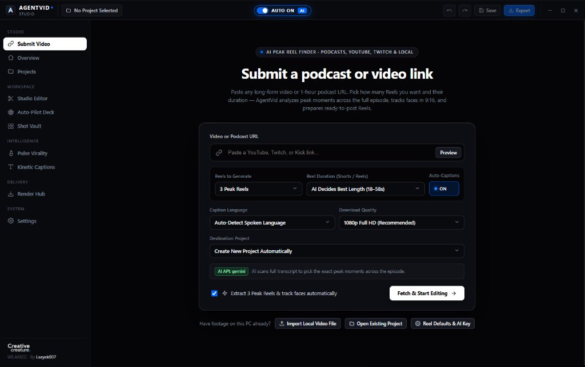
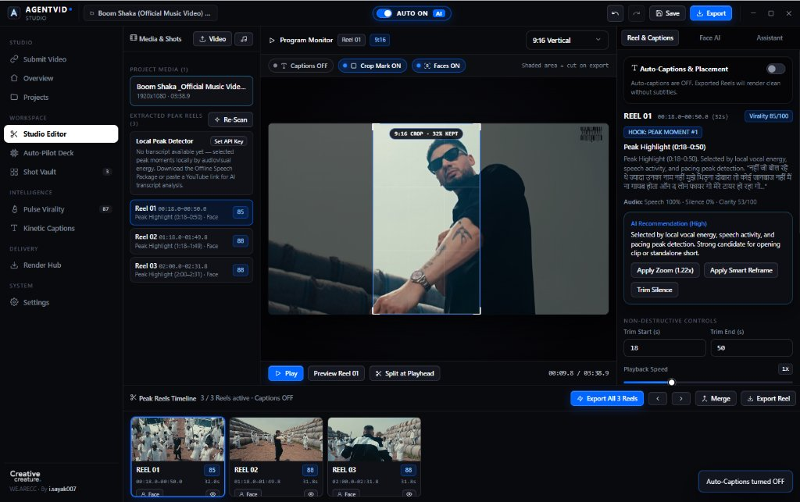
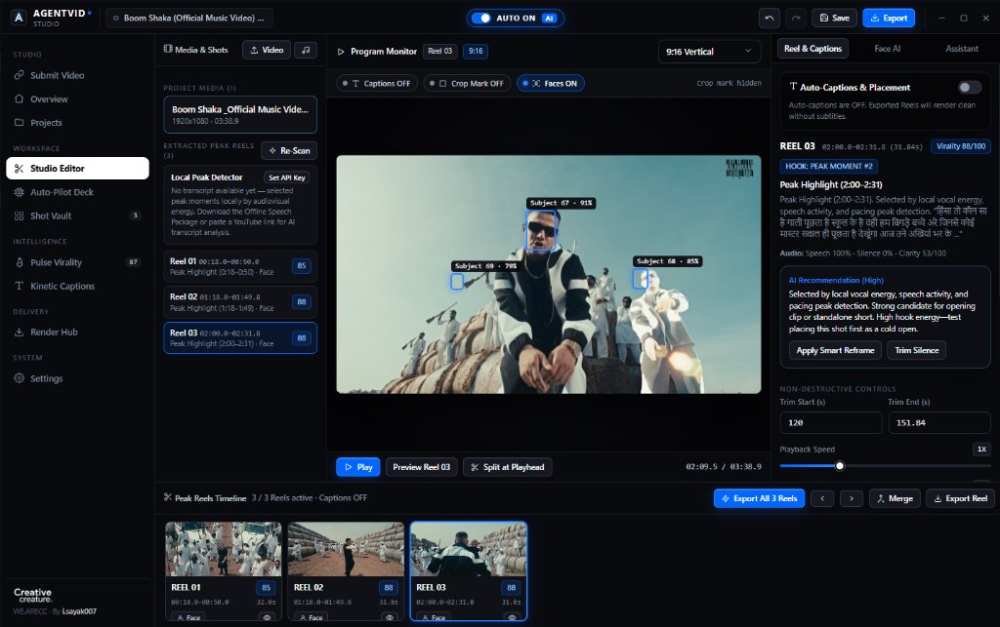
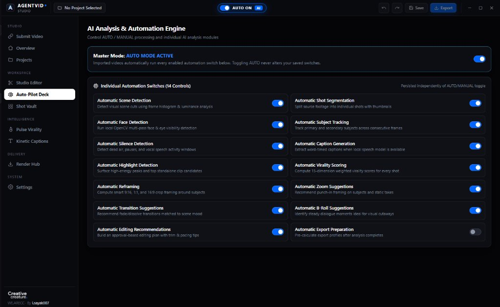

<div align="center">



# AGENTVID — Free AI Video Creation, Podcast-to-Reels & Editing Studio

**Turn 1-hour podcasts, YouTube videos, Twitch VODs, and local footage into viral 9:16 Instagram Reels, YouTube Shorts, and TikToks — 100% Free, Local-First, Zero Watermarks.**

[](LICENSE)
[](https://github.com/allmybusinessorg/Agentvid-/releases/latest)
[](#why-agentvid-beats-paid-ai-reel-cutters)
[](https://isayak007.vercel.app/)
[-0066FF?style=for-the-badge)](https://www.instagram.com/we.arecc/)

### ⬇️ **[Download AgentVid Standalone Desktop Installer (Windows x64 — Free)](https://github.com/allmybusinessorg/Agentvid-/releases/latest)**
*100% standalone desktop software — no Python, no Node.js, no terminal, and no cloud account required. Just download **`AgentVid-Setup-1.0.0-x64.exe`**, install, and start creating.*

[Download](#-quick-start) · [Features](#-key-features) · [Screenshots](#-inside-agentvid-studio) · [Why AgentVid Wins](#-why-agentvid-beats-paid-ai-reel-cutters) · [Build Standalone EXE](#-build-windows-exe--installer) · [Credits](#-credits--community)

</div>

---

## What Is AgentVid?

**AgentVid** is a standalone **AI Video Creation & Editing Desktop Studio** created by **[i.sayak007](https://isayak007.vercel.app/)** and powered by **[Creative Creature (WE.ARECC)](https://www.instagram.com/we.arecc/)**.

Built as a **100% free, local-first, open-source alternative to paid cloud clip cutters** (like OpusClip, Vizard, Klap, Munch, and Submagic), AgentVid lets creators, podcasters, editors, and agencies paste any YouTube / Twitch / Kick URL or drop a local video file to automatically:

1. **Find the exact peak viral moments** across an entire 1-hour+ podcast or video (never blind sequential start-to-end slicing).
2. **Track faces live with local neural ONNX AI** and smart-reframe into **9:16 Vertical**, **1:1 Square**, or **16:9 Landscape** with a toggleable **live Crop Mark** showing exactly what stays vs. gets cut before you export.
3. **Generate dynamic, voice-synchronized auto-captions in 20+ languages** (including English, Hindi, Hinglish, Bengali, Banglish, Urdu, Tamil, Telugu, Spanish, Arabic, and more) with **Liquid Metal Silver, Molten Gold, Glossy Pink Chrome, Moving Gradients, custom `.ttf`/`.otf` fonts, 2D drag-to-move (X & Y), and a size slider**.
4. **Batch-render up to 20 ready-to-post Reels/Shorts** locally on your own GPU/CPU with FFmpeg — **no subscriptions, no upload wait times, no watermarks, and no usage caps**.

<div align="center">
  
</div>

---

## Inside AgentVid Studio

### 1. Paste a Link, Pick Your Reel Count & Let AI Find the Peak Moments
Paste any YouTube, Twitch, or Kick video or 1-hour podcast link. Choose how many Peak Reels you want (**1–20 Reels**), choose **AI Decides Best Length (`18–58s` Shorts/Reels)** or **Fixed Length (`15s / 30s / 45s / 60s`)**, pick your **Caption Language**, toggle **Auto-Captions ON/OFF**, and hit **Fetch & Start Editing**.

<div align="center">
  
</div>

### 2. Live 9:16 / 1:1 / 16:9 Aspect-Ratio Crop Mark & Peak Reels Timeline
Never guess what gets cut off when converting horizontal podcasts or music videos into vertical Reels. Toggle **`Crop Mark ON / OFF`** to preview the exact shaded cut-off zones, corner brackets, rule-of-thirds safe grid, and live kept-area percentage (`9:16 CROP · 32% KEPT`) matching the final FFmpeg render 1:1. Inspect every extracted Peak Reel on the visual timeline and batch-render all Reels in one click.

<div align="center">
  
</div>

### 3. Live Local AI Face Detection & Multi-Subject Tracking (Zero Cloud Uploads)
Powered by a bundled **OpenCV YuNet Neural ONNX** 5-point landmark detector running 100% locally on your PC, AgentVid detects multiple subjects in real time (`Subject 67 · 91%`, `Subject 68 · 85%`, `Subject 69 · 79%`), locks onto the primary foreground speaker, and automatically computes headroom-safe `9:16` vertical framing.

<div align="center">
  
</div>

### 4. Auto-Pilot Deck — 14 Independent AI Automation Switches
Full control over your workflow: flip the master **`AUTO ON / MANUAL`** switch anytime without losing your saved preferences across 14 independent automation modules (Scene Detection, Shot Segmentation, Face Detection, Subject Tracking, Silence Detection, Caption Generation, Highlight Detection, Virality Scoring, Smart Reframing, Zoom, Transitions, B-Roll Suggestions, Editing Plan, and Export Prep).

<div align="center">
  
</div>

---

## Why AgentVid Beats Paid AI Reel Cutters

| Capability | AgentVid Studio (Creative Creature) | Typical Paid Cloud Clip Cutters (OpusClip, Vizard, Klap, Munch) |
| :--- | :--- | :--- |
| **Price & Watermarks** | **100% Free forever · Zero watermarks · Unlimited exports** | $19–$99/month subscriptions, minute caps, watermarks on free tier |
| **Privacy & Speed** | **100% Local-First Desktop App** — video rendering & face AI run on your PC | Must upload GBs of raw footage to cloud queues and wait |
| **Live AI Face Detection & Tracking** | **Built-in Local YuNet Neural ONNX** with live multi-subject boxes & focus override | Black-box cloud auto-crop with no live face bounding preview |
| **Live Render Crop Mark (9:16 / 1:1 / 16:9)** | **Interactive toggleable Crop Mark** showing exact shaded cut-off areas before export | Blind export or limited preview |
| **AI Peak Moment Selection** | **Bring Your Own AI Key** (Gemini, OpenAI, Groq, Claude, Grok, OpenRouter, or **Free Local Ollama**) + Local Peak Fallback | Locked to proprietary credits and quotas |
| **Multi-Language Voice Captions** | **20+ Languages** incl. **Hindi, Hinglish, Bengali, Banglish, Urdu, Tamil, English** + Auto-Translate → English via AI Audio or Offline Speech Model | Often breaks or charges extra for Hinglish / regional Indian languages |
| **Caption Styling & Placement** | **19 Presets** incl. **Liquid Metal Silver, Molten Gold, Glossy Pink Chrome, Moving Hyper-Gradients** + **Upload Custom `.ttf`/`.otf` Fonts** + **Free 2D Drag (X & Y) + Size Slider** | Fixed templates, locked font library, limited placement |
| **Full Non-Destructive Editor** | **Trim, split, merge, reorder, zoom, pan, speed, transitions, undo/redo, autosave & crash recovery** | Basic trim-only web viewers |
| **Transparent Virality Analytics** | **15-Dimension Weighted Pulse Virality Model** showing exact Hook, Story, Audio, Face & Pacing breakdowns | Opaque single score with no breakdown |

---

## Key Features

- **AI Podcast-to-Reels Peak Finder:** Analyzes full transcripts + vocal loudness spikes across 1-hour+ videos to extract **1–20 non-overlapping Peak Reels** with AI-written hooks, titles, and editorial reasons — either **AI-Decided Shorts/Reels Length (`18–58s`)** or **Fixed Duration (`15s / 30s / 45s / 60s`)**.
- **Direct Link Ingestion:** Paste YouTube, Twitch, or Kick URLs for 1-click metadata preview, up to 4K/1080p local download, and native timed caption extraction.
- **Live Local Neural Face AI:** OpenCV YuNet ONNX face & 5-point eye landmark tracking with foreground speaker priority, primary subject focus selector, and automatic 9:16 / 1:1 / 16:9 reframing.
- **Interactive Crop Mark Overlay:** Toggle **`Crop Mark ON / OFF`** in the Program Monitor to inspect the exact shaded cut-off zones and safe frame before rendering.
- **Multi-Language Voice-Synced Auto-Captions:**
  - Direct AI Audio transcription via **Gemini**, **Groq (`whisper-large-v3-turbo`)**, or **OpenAI (`whisper-1`)** for ultra-accurate voice-synced captions in **20+ languages** (Hindi, Hinglish, Bengali, Banglish, Urdu, Tamil, Telugu, Marathi, Gujarati, Punjabi, English, Spanish, French, German, Arabic, Japanese, Korean, and Auto-Translate to English).
  - Optional one-click **Offline Speech-to-Text Package** (`sherpa-onnx`, no API key required) for offline English local videos.
  - Pause-aware cue engine ensures captions always change dynamically with the speaker's voice and never freeze across silence.
- **19 Handcrafted Kinetic Caption Presets + Custom Fonts:**
  - **Animated Shader FX:** Liquid Metal Silver, Molten Gold, Glossy Pink Chrome, Hyper Moving Gradient, Cobalt Wave, Solar Plasma (rendered directly into exported MP4s).
  - **Minimal & Editorial Presets:** Liquid Glass, Swiss Minimal, Whisper Mono, Bold Editorial, Kinetic Typography, Word-by-Word Reveal, and more.
  - **Custom Font Upload:** Drag/upload your own `.ttf` or `.otf` fonts and see them live in preview and final renders.
  - **2D Drag-to-Move (Horizontal X & Vertical Y) + Size Slider (`28px–120px`)** right inside the Studio Editor and Settings.
- **Pulse Virality Engine (15 Dimensions):** Transparent weighted scoring across Opening Hook, Emotional Impact, Visual Engagement, Human Presence, Facial Expression, Movement, Info Value, Storytelling, Audio Clarity, Speech Clarity, Subject Visibility, Composition, Standalone Potential, Pacing, and Ending Strength.
- **Hardware-Accelerated FFmpeg Render Hub:** Batch-export all extracted Reels or individual shots in **H.264 / H.265**, **720p / 1080p / 4K**, **24 / 30 / 60 fps**, with automatic **NVENC / Intel QSV GPU acceleration + CPU fallback** and loudness normalization (`-14 LUFS`).

---

## Quick Start

### Option 1: Download Standalone Windows Desktop Software (Recommended for Everyone)
AgentVid ships as a **self-contained Windows desktop application** with the local AI engine, OpenCV YuNet face tracker, fonts, and desktop UI bundled inside — **no coding, no Python, no Node.js required**.

1. Go to **[Releases → Latest](https://github.com/allmybusinessorg/Agentvid-/releases/latest)**.
2. Download **`AgentVid-Setup-1.0.0-x64.exe`** and run the installer.
3. Launch **AgentVid** from your Desktop or Start Menu, paste a YouTube/podcast link (or import a local MP4/MOV/MKV), and start generating Reels immediately.
4. *(Optional — Recommended for 1-hour Podcasts & Non-English Captions)* Open **Settings → AI Provider API Key** and connect your **Gemini**, **Groq**, **OpenAI**, **Claude**, **Grok**, **OpenRouter**, or local **Ollama** key.

> **Note:** Make sure FFmpeg is installed on Windows (one-command install in PowerShell: `winget install Gyan.FFmpeg` if you don't already have it).

### Option 2: Run From Source (Developers)

**Prerequisites:** Python `3.11+` (tested on Python `3.14`), FFmpeg on `PATH`, and Node.js `18+` (only if launching the Electron desktop shell).

```powershell
# 1. Clone the repository
git clone https://github.com/allmybusinessorg/Agentvid-.git
cd Agentvid-

# 2. Create a Python virtual environment & install dependencies
python -m venv .venv
.\.venv\Scripts\python.exe -m pip install -r requirements.txt

# 3. Start the local AgentVid Studio server (opens in browser at http://127.0.0.1:8765)
.\.venv\Scripts\python.exe -m studio.agentvid_entry --host 127.0.0.1 --port 8765
```

Or launch the full **Electron Desktop Window**:

```powershell
cd desktop
npm install
npm start
```

---

## Build Windows EXE & Installer

Package the standalone PyInstaller AI engine + Electron Windows app + NSIS installer in one command:

```powershell
powershell -ExecutionPolicy Bypass -File scripts\build_windows.ps1
```

Outputs are generated in `dist-desktop/`:
- `dist-desktop/win-unpacked/AgentVid.exe` — Portable Windows desktop app
- `dist-desktop/AgentVid-Setup-1.0.0-x64.exe` — Windows x64 NSIS installer

---

## Running Automated Tests

```powershell
.\.venv\Scripts\python.exe -m pytest tests\test_agentvid.py -v
```

---

## Architecture & Security

- **[ARCHITECTURE.md](ARCHITECTURE.md)** — Local desktop architecture, PyInstaller engine, YuNet ONNX face tracking, shader caption pipeline, and FFmpeg render graph.
- **[SECURITY.md](SECURITY.md)** — Local-first privacy guarantees, path traversal protection, and safe local API key storage.
- **[THIRD_PARTY_NOTICES.md](THIRD_PARTY_NOTICES.md)** — Full open-source licenses and upstream attributions.

---

## Credits & Community

<div align="center">

**AgentVid — AI Video Creation & Editing Studio**  
Created by **[i.sayak007](https://isayak007.vercel.app/)** · A product of **[Creative Creature (WE.ARECC)](https://www.instagram.com/we.arecc/)**

[](https://isayak007.vercel.app/)
[](https://www.instagram.com/we.arecc/)

If AgentVid saves you hours of editing or replaces a paid subscription, **give this repo a Star** and follow **[@we.arecc](https://www.instagram.com/we.arecc/)** on Instagram for more free AI creator tools!

</div>

---

## License

Released under the **MIT License** — see [LICENSE](LICENSE) and [THIRD_PARTY_NOTICES.md](THIRD_PARTY_NOTICES.md) for full details.
